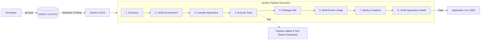

# DevOps Pipeline for Automated Java Application Release Using Jenkins and Docker

> **Academic Mini-Project**  
> **Domain**: DevOps, Continuous Integration / Continuous Deployment (CI/CD), Cloud-Native Application Development  
> **Target Environment**: Windows 11 / Antigravity IDE  

---

## 1. Project Overview

This project implements a complete, automated end-to-end CI/CD release pipeline for a cloud-ready **Student Management System** built with **Java 21**, **Spring Boot 3**, and **Bootstrap 5**.

Whenever a developer pushes code changes to the Git repository, the automated Jenkins pipeline triggers a multi-stage release cycle that compiles the source code, runs automated unit and integration tests, packages a standalone executable JAR, builds an optimized Docker container image, deploys the container, and verifies health status via Spring Boot Actuator endpoints.

---

## 2. Problem Statement

In traditional software development workflows, building, testing, packaging, and deploying applications are manual tasks prone to human error, environmental inconsistencies ("it works on my machine" syndrome), and delayed feedback loops. 

This project solves these issues by automating the software delivery lifecycle using modern DevOps practices:
- Automated quality gates via **JUnit 5** to halt faulty code before release.
- Immutable packaging with **Docker** to ensure identical behavior across developer laptops and production servers.
- Automated pipeline orchestration using **Jenkins** for fast, repeatable, and observable deployments.

---

## 3. Project Objectives

1. **Develop a Microservice-Style Web Application**: Build a responsive Student Management dashboard with full CRUD capabilities, instant search, and RESTful APIs using Spring Boot and H2.
2. **Automated Testing Suite**: Create isolated unit tests and MockMvc integration tests with high code coverage.
3. **Containerization**: Create an optimized, non-root Docker image based on lightweight Alpine JRE 21.
4. **CI/CD Pipeline as Code**: Define a declarative `Jenkinsfile` orchestrating checkout, compilation, test execution, packaging, container building, local deployment, and health verification.
5. **Observability**: Expose application health metrics via Spring Boot Actuator for automated pipeline validation.

---

## 4. Technologies Used

| Category | Technology | Version | Purpose |
|---|---|---|---|
| **Programming Language** | Java (Eclipse Adoptium OpenJDK) | 21 LTS | Core application language |
| **Backend Framework** | Spring Boot | 3.3.5 | REST API, DI, embedded Tomcat server |
| **Data Persistence** | Spring Data JPA / Hibernate | 6.5.x | ORM & data access abstraction |
| **Database** | H2 Database | 2.x | Lightweight embedded/file-based SQL storage |
| **Frontend UI** | HTML5, CSS3, JavaScript, Bootstrap | 5.3.3 | Responsive user dashboard & AJAX client |
| **Build Tool** | Apache Maven & Maven Wrapper | 3.9.x | Dependency management & lifecycle build |
| **Testing Framework** | JUnit 5 & Mockito & MockMvc | Latest Spring Boot | Unit & integration test suite |
| **Version Control** | Git & GitHub | 2.x | Source control & commit tracking |
| **Credential Management** | Git Credential Manager | 2.9.1 | Browser-based GitHub sign-in, token never stored in the repo |
| **CI/CD Orchestration**| Jenkins LTS | 2.x | Automated multi-stage pipeline runner |
| **Containerization** | Docker Desktop & Docker Engine | 29.x | Containerization & local deployment |

---

## 5. System Architecture

### CI/CD Pipeline Workflow



---

## 6. Application Features

1. **Interactive Metrics Dashboard**: Live counter cards showing total enrolled students and system status.
2. **Student Record Management (CRUD)**:
   - Add new students with field validation.
   - View all students in a responsive tabular interface.
   - Update student name, email, department, or semester.
   - Delete students with confirmation prompts.
3. **Instant Search**: Filter student records in real time by student name or academic department.
4. **Input Validation**: Backend Bean Validation (`@NotBlank`, `@Email`, `@Min`, `@Max`) with custom error messaging.
5. **Production Health Checks**: Live Spring Boot Actuator endpoint (`/actuator/health`) detailing database and application readiness.

---

## 7. Project Folder Structure

```text
student-management/
├── .mvn/wrapper/                          # Maven Wrapper binaries & properties
├── src/
│   ├── main/
│   │   ├── java/com/devops/studentmgmt/
│   │   │   ├── StudentManagementApplication.java  # Main application entrypoint
│   │   │   ├── controller/
│   │   │   │   └── StudentController.java         # REST endpoints + validation error handling
│   │   │   ├── model/
│   │   │   │   └── Student.java                   # JPA Entity with Bean Validation
│   │   │   ├── repository/
│   │   │   │   └── StudentRepository.java         # Spring Data JPA queries
│   │   │   └── service/
│   │   │       ├── StudentService.java            # Business logic contract
│   │   │       └── StudentServiceImpl.java        # Business logic implementation
│   │   └── resources/
│   │       ├── application.properties             # H2 DB & Actuator configuration
│   │       ├── application-docker.properties      # Docker profile (file-based H2 in /app/data)
│   │       └── static/
│   │           ├── index.html                     # Responsive Bootstrap 5 UI
│   │           ├── css/style.css                  # Custom styling
│   │           └── js/app.js                      # Dashboard, search & CRUD (event delegation)
│   └── test/
│       ├── java/com/devops/studentmgmt/
│       │   ├── StudentServiceTest.java            # 8 Mockito unit tests
│       │   ├── StudentControllerTest.java         # 9 MockMvc API tests
│       │   └── StudentIntegrationTest.java        # 23 @SpringBootTest end-to-end tests
│       └── resources/
│           └── application.properties             # In-memory H2 config for tests
├── .dockerignore                  # Docker context exclusions
├── .gitignore                     # Git tracking exclusions
├── docker-compose.yml             # Single-command Docker Compose specification
├── Dockerfile                     # Optimized Alpine JRE 21 container spec
├── Jenkinsfile                    # Declarative multi-stage CI/CD pipeline
├── env.bat / env.ps1              # JDK 21 auto-detect helpers for the local shell
├── mvnw / mvnw.cmd                # Maven wrapper for Linux agents / Windows
└── pom.xml                        # Maven project dependencies and build plugins
```

---

## 8. Installation & Prerequisites (Windows 11)

### 1. Java 21 (Adoptium Temurin)
1. Download OpenJDK 21 installer from [adoptium.net](https://adoptium.net).
2. Install to default path (e.g. `C:\Program Files\Eclipse Adoptium\jdk-21.0.12.101-hotspot`).
3. Set environment variable `JAVA_HOME` pointing to this directory and add `%JAVA_HOME%\bin` to your `PATH`.

### 2. Docker Desktop & WSL 2
Docker Desktop on Windows 11 requires the Windows Subsystem for Linux (WSL 2) backend:
1. Open PowerShell **as Administrator** and run:
   ```powershell
   wsl --install
   ```
2. Restart Windows when prompted.
3. Launch **Docker Desktop** from the Start Menu. Under **Settings > General**, ensure "Use the WSL 2 based engine" is checked.
4. Verify Docker daemon is running by opening PowerShell:
   ```powershell
   docker --version
   docker ps
   ```

### 3. Jenkins LTS (Docker)
Jenkins runs as a container in this project, with the Docker socket mounted so the pipeline can build and deploy images:

```powershell
cd d:\robot_simulation\devops\jenkins
docker compose up -d
```

This publishes Jenkins on `http://localhost:9090` (agent port `50000`) and mounts `/var/run/docker.sock` into the container. Wait for the container to report healthy, then open `http://localhost:9090`, unlock it with the initial admin password from the container log, and complete the setup wizard:

```powershell
# Retrieve the initial admin password
docker exec jenkins-server cat /var/jenkins_home/secrets/initialAdminPassword
```

To run Jenkins natively instead (Windows service or `jenkins.war`), use:

```powershell
java -jar jenkins.war --httpPort=9090
```

Note: a natively installed Jenkins on Windows cannot reach the Docker Desktop Linux engine unless the socket is exposed, which is why the containerized setup above is used.

---

## 9. Running the Application Locally

### Using Maven Wrapper (No Maven installation required)
```powershell
# Navigate to the project directory
cd d:\robot_simulation\devops\student-management

# Run Spring Boot
.\mvnw.cmd spring-boot:run
```

### Running the Packaged JAR
```powershell
# 1. Package the JAR
.\mvnw.cmd clean package

# 2. Run the JAR with Java 21
java -jar target\student-management-1.0.0.jar
```

Access the application in your browser:
- **UI Dashboard**: `http://localhost:8080`
- **H2 Web Console**: `http://localhost:8080/h2-console` (JDBC URL: `jdbc:h2:file:./data/studentdb`, User: `sa`, Password: empty)
- **Actuator Health Check**: `http://localhost:8080/actuator/health`

---

## 10. Docker Build & Deployment Instructions

### 1. Build the Docker Image
```powershell
cd d:\robot_simulation\devops\student-management

# Build Docker container image
docker build -t student-management:1.0.0 -t student-management:latest .
```
### 2. Run the Docker Container

```powershell
# Run container with port forwarding and volume persistence
docker run -d `
  --name student-management-app `
  --restart unless-stopped `
  -p 8081:8080 `
  -v student-management_student-data:/app/data `
  -e SPRING_PROFILES_ACTIVE=docker `
  student-management:latest
```

The application is then reachable at `http://localhost:8081` (host port `8081` ➔ container port `8080`). The named volume `student-management_student-data` keeps the H2 database in `/app/data` so data survives container recreation.

### 3. Using Docker Compose (Simplest)
```powershell
# Start container in detached mode
docker compose up -d

# Check running status and health check
docker compose ps

# View real-time logs
docker compose logs -f

# Stop container
docker compose down
```

---

## 11. Jenkins Setup & Pipeline Configuration

### Step 1: Install Required Plugins
In Jenkins (`http://localhost:9090`):
1. Navigate to **Manage Jenkins > Plugins > Available Plugins**.
2. Install the following plugins:
   - **Pipeline**
   - **Git Plugin**
   - **JUnit Plugin**
   - **Docker Pipeline** (optional if using command-line docker)

### Step 2: Configure Global Tools
1. Navigate to **Manage Jenkins > Tools**.
2. **JDK**: Click *Add JDK*, name it `JDK21`, and uncheck *Install automatically*. Set `JAVA_HOME` to your JDK path (e.g. `C:\Program Files\Eclipse Adoptium\jdk-21.0.12.101-hotspot`).
3. **Maven**: Click *Add Maven*, name it `Maven3`, and check *Install automatically* (select version 3.9.x).

### Step 3: Create the Pipeline Job
1. Click **New Item**, enter **student-management-pipeline**, choose **Pipeline**, and click **OK**.
2. Under **Pipeline**, set **Definition** to **Pipeline script from SCM**.
3. Set **SCM** to **Git** and **Repository URL** to:
   https://github.com/amritkiyursmilx-ux/devops-student-management.git
4. Set **Branch Specifier** to ***/main** and **Script Path** to **Jenkinsfile** (the repository root).
5. The repository is public, so no Jenkins credential is required. If it becomes private, select a credential from Jenkins Credentials; never paste a token into the Jenkinsfile.
6. Under **Triggers**, tick **Poll SCM** and enter the schedule `H/5 * * * *` so a new push to `main` is picked up automatically every 5 minutes.
7. Click **Save**.

### Step 4: Run the Pipeline
1. Click **Build Now** in the left sidebar.
2. Observe each stage progress in the **Stage View**:
   - `Checkout` ➔ `Verify Environment` ➔ `Compile Application` ➔ `Execute Tests` ➔ `Package JAR` ➔ `Build Docker Image` ➔ `Deploy Container` ➔ `Verify Application Health`.
3. View the JUnit test trends and archived `.jar` artifacts in the build summary.

---

## 12. GitHub Integration & Automated Triggers

The project remote is https://github.com/amritkiyursmilx-ux/devops-student-management.git, on branch **main**. Configure the Jenkins job to use **Pipeline script from SCM**, branch ***/main**, and script path **Jenkinsfile**.

### Pushing Code to GitHub

GitHub no longer accepts account passwords for Git operations. This machine uses **Git Credential Manager (GCM)**, so the first push opens a browser window for a one-time GitHub sign-in and then caches the credential in Windows Credential Manager:

```powershell
# Verify the credential helper is active
git config --get-all credential.helper

# Push the current branch (a browser sign-in prompt appears on first use)
git push -u origin main
```

The token is never written into the repository, the `Jenkinsfile`, or any config file.

### Triggering Builds Automatically

Two trigger options are available:

| Trigger | How it works | When to use it |
|---|---|---|
| **Poll SCM** (`H/5 * * * *`) | Jenkins checks GitHub every 5 minutes for new commits on `main` and builds automatically | Jenkins runs on a local machine that GitHub cannot reach |
| **GitHub hook trigger** | GitHub POSTs to `http://<reachable-jenkins-host>:9090/github-webhook/` on every push | Jenkins is reachable from the internet (e.g. via a tunnel or a self-hosted runner) |

**Poll SCM is the trigger configured in this project**, because the Jenkins server runs on `localhost` and GitHub cannot reach that address. The job is set to **Pipeline script from SCM** with branch `*/main`, so a new push to `main` is picked up automatically on the next poll.

To switch to a webhook instead, enable **GitHub hook trigger for GITScm polling** in the job and add a GitHub push webhook pointing at the Jenkins URL above. Keep Jenkins behind an authenticated, protected endpoint, and always use Jenkins Credentials for secrets - never paste a token into the `Jenkinsfile`.

---

## 13. Testing Instructions

### Run Unit & Integration Tests (Locally)

```powershell
cd student-management
.\mvnw.cmd test
```

### Run the Full Verify Lifecycle (what the pipeline runs)

```powershell
.\mvnw.cmd clean verify
```

### Run Tests with Coverage Report

```powershell
.\mvnw.cmd test jacoco:report   # If JaCoCo is configured
```

### Inspecting Test Reports

Maven writes XML and text test reports to:

- `target/surefire-reports/com.devops.studentmgmt.service.StudentServiceTest.txt`
- `target/surefire-reports/com.devops.studentmgmt.controller.StudentControllerTest.txt`
- `target/surefire-reports/com.devops.studentmgmt.StudentIntegrationTest.txt`

The pipeline publishes these as JUnit results, so they are viewable from the **Test Result** link on the build page.

### Manual API Testing (curl/PowerShell)

```powershell
# Get all students
Invoke-RestMethod -Uri http://localhost:8081/api/students

# Get student count
Invoke-RestMethod -Uri http://localhost:8081/api/students/count

# Search students
Invoke-RestMethod -Uri "http://localhost:8081/api/students/search?query=John"

# Health check
Invoke-RestMethod -Uri http://localhost:8081/actuator/health
```

### Tested Scenarios

| Test Class | Test Case | Target Behavior |
|---|---|---|
| `StudentServiceTest` | `testCreateStudent_Success` | Successfully creates and persists student |
| `StudentServiceTest` | `testCreateStudent_DuplicateEmail` | Throws exception when duplicate email is provided |
| `StudentServiceTest` | `testGetStudentById_NotFound` | Handles invalid ID with ResourceNotFoundException |
| `StudentServiceTest` | `testUpdateStudent_Success` | Updates existing student attributes |
| `StudentServiceTest` | `testDeleteStudent_Success` | Deletes student by ID |
| `StudentServiceTest` | `testSearchStudents` | Finds students matching partial name or dept |
| `StudentControllerTest`| `testCreateStudent_Success` | Returns HTTP 201 Created with JSON body |
| `StudentControllerTest`| `testCreateStudent_ValidationErrors` | Returns HTTP 400 Bad Request with field errors |
| `StudentControllerTest`| `testGetAllStudents` | Returns HTTP 200 OK with student array |
| `StudentControllerTest`| `testSearchStudents` | Returns HTTP 200 OK with filtered results |
| `StudentControllerTest`| `testDeleteStudent` | Returns HTTP 200 OK confirmation message |
| `StudentIntegrationTest` | 23 tests across `CreateTest`, `ReadTest`, `UpdateTest`, `DeleteTest`, `HealthTest` | Full-stack `@SpringBootTest` + `MockMvc` coverage of CRUD, search, count, validation and the Actuator health endpoint against a real in-memory H2 database |

**Total: 40 automated tests** (8 service + 9 controller + 23 integration), all passing in the pipeline.

## 14. API Endpoints & Expected Outputs

| Method | Endpoint | Description | Sample Request Body / Parameter | Expected Status |
|---|---|---|---|---|
| `GET` | `/api/students` | Get all students | None | `200 OK` |
| `GET` | `/api/students/{id}` | Get student by ID | Path variable `id=1` | `200 OK` / `404 Not Found` |
| `POST` | `/api/students` | Create student | `{"fullName":"Ramesh Kumar","email":"ramesh@cs.edu","department":"Computer Science","semester":3}` | `201 Created` |
| `PUT` | `/api/students/{id}` | Update student | `{"fullName":"Ramesh Kumar","email":"ramesh@cs.edu","department":"Computer Science","semester":4}` | `200 OK` |
| `DELETE` | `/api/students/{id}` | Delete student | Path variable `id=1` | `200 OK` |
| `GET` | `/api/students/search` | Search students | `?query=Computer` | `200 OK` |
| `GET` | `/api/students/count` | Total count | None | `200 OK` (`3`) |
| `GET` | `/actuator/health` | Health Check | None | `200 OK` (`{"status":"UP"}`) |

### Expected Outputs

| Action | Expected Result |
|---|---|
| `mvnw.cmd clean compile` | `BUILD SUCCESS` - All source files compiled |
| `mvnw.cmd test` | `BUILD SUCCESS` - 40 tests run (8 service + 9 controller + 23 integration), 0 failures |
| `mvnw.cmd clean verify` | `BUILD SUCCESS` - `target/student-management-1.0.0.jar` created (~49 MB) |
| `docker build` | Successfully built image `student-management:1.0.0` |
| `docker compose up -d` | Container `student-management-app` starts and becomes healthy |
| `http://localhost:8081/actuator/health` | `{"status":"UP", "components":{"db":{"status":"UP"},...}}` |
| `http://localhost:8081/api/students/count` | JSON with total student count |
| `http://localhost:8081` | Bootstrap UI loads with dashboard, table, and CRUD functionality |

---

## 15. Common Errors & Troubleshooting

| Error | Cause | Solution |
|---|---|---|
| `mvn` not found | Maven not on PATH | Use `mvnw.cmd` (Maven Wrapper) instead of `mvn` |
| Port 8080 already in use | Another instance of Spring Boot or Tomcat is running | Stop the existing process or run `Get-Process -Id (Get-NetTCPConnection -LocalPort 8080).OwningProcess | Stop-Process -Force` |
| Port 8081 already in use | Another process using the Docker port mapping | Stop the process or change the port in `docker-compose.yml` |
| `docker : failed to connect to the docker API` | Docker Desktop is stopped or WSL 2 is not enabled | Run `wsl --install` in an Administrator PowerShell, reboot, and launch Docker Desktop from the Start Menu |
| Jenkins tool not found (`JDK21` / `Maven3`) | Tool names in `Jenkinsfile` don't match the names configured under **Manage Jenkins > Tools** | Ensure the names in Jenkins Global Tool Configuration match `JDK21` and `Maven3` exactly |
| Docker build fails - JAR not found | JAR not packaged yet | Run `mvnw.cmd package -DskipTests` before building the image |
| Container fails to start | Wrong profile or volume issues | Ensure `SPRING_PROFILES_ACTIVE=docker` and the volume is mounted to `/app/data` |
| Jenkins can't access Docker | Docker Desktop socket access issue on Windows | Use the provided `jenkins/` Docker setup with the socket mounted; a Windows Jenkins service may not have Docker access |
| Tests fail in pipeline | Code changes break tests | Fix failing tests locally with `mvnw.cmd test` before pushing - the pipeline halts at the `Execute Tests` stage and the deploy stages are skipped |
| H2 data lost after container recreation | Volume not mounted | Ensure the named volume `student-management_student-data` is mounted to `/app/data` |
| Health check fails | App still starting | Increase the wait time in the health check stage (the app needs ~20-30s to start) |
| `remote: Invalid username or token` | Git tried to authenticate with an account password, which GitHub no longer accepts | Use Git Credential Manager (browser sign-in) or a Personal Access Token with `Contents: Read and write` |
| `git push` hangs with no output | Waiting for the browser sign-in window | Switch to the Edge window titled *"Confirm access and 5 more pages"* and click **Continue**, then **Authorize github** |
| UTF-8 Byte Order Mark (BOM) compilation error | Windows PowerShell `Set-Content` writing UTF-8 with a BOM prefix | Ensure files are saved as pure UTF-8 without BOM (already configured in this repository) |

---

## 16. Future Enhancements

1. **Authentication & Authorization**: Add Spring Security with role-based access control.
2. **Pagination & Sorting**: Implement pagination for large student datasets.
3. **REST API Documentation**: Integrate Swagger / OpenAPI for API documentation.
4. **Database Migration**: Use Flyway or Liquibase for schema version control.
5. **Kubernetes Deployment**: Add Helm charts and Kubernetes manifests (`deployment.yaml`, `service.yaml`) for container orchestration.
6. **Static Code Analysis**: Integrate SonarQube in the Jenkins pipeline to enforce code quality and security scanning.
7. **Container Vulnerability Scanning**: Add a Trivy scanning stage before the Docker image deployment.
8. **Cloud Deployment**: Automate pushing container images to Docker Hub or AWS ECR and deploying to AWS ECS / Google Cloud Run.
9. **Email Notifications**: Add email alerts for pipeline failures.
10. **Zero-Downtime Deployment**: Replace the single container with a rolling-update strategy using Docker Swarm, Kubernetes, or a blue/green container swap.

---

## Important Notes

- **Port Mapping**: Application is accessible at `http://localhost:8081` (host) with the container listening on port `8080`.
- **Data Persistence**: The H2 database is stored in the Docker volume `student-management_student-data` (mounted at `/app/data`), so data survives container recreation and redeployment.
- **Downtime Limitation**: Replacing a single local container causes brief downtime during deployment (measured at ~11s). This setup does **not** implement zero-downtime deployment.
- **Health Monitoring**: The Spring Boot Actuator health endpoint (`/actuator/health`) is exposed for monitoring and pipeline verification. The pipeline checks it at `http://host.docker.internal:8081/actuator/health` from inside the Jenkins container.
- **Pipeline Stages**: 8 stages run in order - `Checkout`, `Verify Environment`, `Compile Application`, `Execute Tests`, `Package JAR`, `Build Docker Image`, `Deploy Container`, `Verify Application Health`.
- **Build Gate**: A failing test halts the pipeline at `Execute Tests`; the image is not rebuilt and the running container is left untouched.
- **Security**: Use the Jenkins credentials store for any secrets/tokens. Never hardcode credentials in the `Jenkinsfile` or source code.
