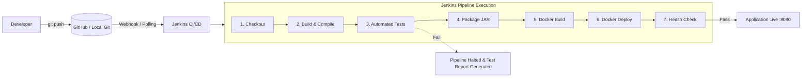

# DevOps Pipeline for Automated Java Application Release Using Jenkins and Docker

> **Academic Mini-Project**  
> **Domain**: DevOps, Continuous Integration / Continuous Deployment (CI/CD), Cloud-Native Application Development  
> **Target Environment**: Windows 11 / Antigravity IDE  

---

## 1. Project Overview

This project implements a complete, automated end-to-end CI/CD release pipeline for a cloud-ready **Student Management System** built with **Java 21**, **Spring Boot 3**, and **Bootstrap 5**.

Whenever a developer pushes code changes to the Git repository, the automated Jenkins pipeline triggers a multi-stage release cycle that compiles the source code, runs automated unit and integration tests, packages a standalone executable JAR, builds an optimized Docker container image, deploys the container, and verifies health status via Spring Boot Actuator endpoints.

---

## 2. Problem Statement

In traditional software development workflows, building, testing, packaging, and deploying applications are manual tasks prone to human error, environmental inconsistencies ("it works on my machine" syndrome), and delayed feedback loops. 

This project solves these issues by automating the software delivery lifecycle using modern DevOps practices:
- Automated quality gates via **JUnit 5** to halt faulty code before release.
- Immutable packaging with **Docker** to ensure identical behavior across developer laptops and production servers.
- Automated pipeline orchestration using **Jenkins** for fast, repeatable, and observable deployments.

---

## 3. Project Objectives

1. **Develop a Microservice-Style Web Application**: Build a responsive Student Management dashboard with full CRUD capabilities, instant search, and RESTful APIs using Spring Boot and H2.
2. **Automated Testing Suite**: Create isolated unit tests and MockMvc integration tests with high code coverage.
3. **Containerization**: Create an optimized, non-root Docker image based on lightweight Alpine JRE 21.
4. **CI/CD Pipeline as Code**: Define a declarative `Jenkinsfile` orchestrating checkout, compilation, test execution, packaging, container building, local deployment, and health verification.
5. **Observability**: Expose application health metrics via Spring Boot Actuator for automated pipeline validation.

---

## 4. Technologies Used

| Category | Technology | Version | Purpose |
|---|---|---|---|
| **Programming Language** | Java (Eclipse Adoptium OpenJDK) | 21 LTS | Core application language |
| **Backend Framework** | Spring Boot | 3.3.5 | REST API, DI, embedded Tomcat server |
| **Data Persistence** | Spring Data JPA / Hibernate | 6.5.x | ORM & data access abstraction |
| **Database** | H2 Database | 2.x | Lightweight embedded/file-based SQL storage |
| **Frontend UI** | HTML5, CSS3, JavaScript, Bootstrap | 5.3.3 | Responsive user dashboard & AJAX client |
| **Build Tool** | Apache Maven & Maven Wrapper | 3.9.x | Dependency management & lifecycle build |
| **Testing Framework** | JUnit 5 & Mockito & MockMvc | Latest Spring Boot | Unit & integration test suite |
| **Version Control** | Git & GitHub | 2.x | Source control & commit tracking |
| **CI/CD Orchestration**| Jenkins LTS | 2.x | Automated multi-stage pipeline runner |
| **Containerization** | Docker Desktop & Docker Engine | 29.x | Containerization & local deployment |

---

## 5. System Architecture

### CI/CD Pipeline Workflow



---

## 6. Application Features

1. **Interactive Metrics Dashboard**: Live counter cards showing total enrolled students and system status.
2. **Student Record Management (CRUD)**:
   - Add new students with field validation.
   - View all students in a responsive tabular interface.
   - Update student name, email, department, or semester.
   - Delete students with confirmation prompts.
3. **Instant Search**: Filter student records in real time by student name or academic department.
4. **Input Validation**: Backend Bean Validation (`@NotBlank`, `@Email`, `@Min`, `@Max`) with custom error messaging.
5. **Production Health Checks**: Live Spring Boot Actuator endpoint (`/actuator/health`) detailing database and application readiness.

---

## 7. Project Folder Structure

```text
student-management/
├── .mvn/wrapper/                  # Maven Wrapper binaries & properties
├── src/
│   ├── main/
│   │   ├── java/com/devops/studentmgmt/
│   │   │   ├── StudentManagementApplication.java  # Main application entrypoint
│   │   │   ├── controller/
│   │   │   │   └── StudentController.java         # REST endpoints (/api/students)
│   │   │   ├── entity/
│   │   │   │   └── Student.java                   # JPA Entity with Bean Validation
│   │   │   ├── exception/
│   │   │   │   └── GlobalExceptionHandler.java    # Centralized REST error handling
│   │   │   ├── repository/
│   │   │   │   └── StudentRepository.java         # Spring Data JPA queries
│   │   │   └── service/
│   │   │       ├── StudentService.java            # Business logic contract
│   │   │       └── impl/StudentServiceImpl.java   # Business logic implementation
│   │   └── resources/
│   │       ├── application.properties             # H2 DB & Actuator configuration
│   │       └── static/
│   │           └── index.html                     # Responsive Bootstrap 5 UI
│   └── test/
│       └── java/com/devops/studentmgmt/
│           ├── controller/
│           │   └── StudentControllerTest.java     # 9 MockMvc API tests
│           └── service/
│               └── StudentServiceTest.java        # 8 Mockito unit tests
├── .dockerignore                  # Docker context exclusions
├── .gitignore                     # Git tracking exclusions
├── docker-compose.yml             # Single-command Docker Compose specification
├── Dockerfile                     # Optimized Alpine JRE 21 container spec
├── Jenkinsfile                    # Declarative multi-stage CI/CD pipeline
├── mvnw.cmd                       # Maven wrapper script for Windows
└── pom.xml                        # Maven project dependencies and build plugins
```

---

## 8. Installation & Prerequisites (Windows 11)

### 1. Java 21 (Adoptium Temurin)
1. Download OpenJDK 21 installer from [adoptium.net](https://adoptium.net).
2. Install to default path (e.g. `C:\Program Files\Eclipse Adoptium\jdk-21.0.12.101-hotspot`).
3. Set environment variable `JAVA_HOME` pointing to this directory and add `%JAVA_HOME%\bin` to your `PATH`.

### 2. Docker Desktop & WSL 2
Docker Desktop on Windows 11 requires the Windows Subsystem for Linux (WSL 2) backend:
1. Open PowerShell **as Administrator** and run:
   ```powershell
   wsl --install
   ```
2. Restart Windows when prompted.
3. Launch **Docker Desktop** from the Start Menu. Under **Settings > General**, ensure "Use the WSL 2 based engine" is checked.
4. Verify Docker daemon is running by opening PowerShell:
   ```powershell
   docker --version
   docker ps
   ```

### 3. Jenkins LTS
1. Download Jenkins Generic Java package (`jenkins.war`) from [jenkins.io](https://www.jenkins.io/download/) or run via Docker:
   ```powershell
   docker run -d -p 8085:8080 -p 50000:50000 --name jenkins-server -v jenkins_home:/var/jenkins_home jenkins/jenkins:lts
   ```
2. Or run natively on Windows via Java:
   ```powershell
   java -jar jenkins.war --httpPort=8085
   ```
3. Open `http://localhost:8085` in your browser and complete the initial setup wizard.

---

## 9. Running the Application Locally

### Using Maven Wrapper (No Maven installation required)
```powershell
# Navigate to the project directory
cd d:\robot_simulation\devops\student-management

# Run Spring Boot
.\mvnw.cmd spring-boot:run
```

### Running the Packaged JAR
```powershell
# 1. Package the JAR
.\mvnw.cmd clean package

# 2. Run the JAR with Java 21
java -jar target\student-management-1.0.0.jar
```

Access the application in your browser:
- **UI Dashboard**: `http://localhost:8080`
- **H2 Web Console**: `http://localhost:8080/h2-console` (JDBC URL: `jdbc:h2:file:./data/studentdb`, User: `sa`, Password: empty)
- **Actuator Health Check**: `http://localhost:8080/actuator/health`

---

## 10. Docker Build & Deployment Instructions

### 1. Build the Docker Image
```powershell
cd d:\robot_simulation\devops\student-management

# Build Docker container image
docker build -t student-management:1.0.0 -t student-management:latest .
```

### 2. Run the Docker Container
```powershell
# Run container with port forwarding and volume persistence
docker run -d `
  --name student-management-app `
  -p 8080:8080 `
  -v student-data:/app/data `
  student-management:latest
```

### 3. Using Docker Compose (Simplest)
```powershell
# Start container in detached mode
docker compose up -d

# Check running status and health check
docker compose ps

# View real-time logs
docker compose logs -f

# Stop container
docker compose down
```

---

## 11. Jenkins Setup & Pipeline Configuration

### Step 1: Install Required Plugins
In Jenkins (`http://localhost:8085`):
1. Navigate to **Manage Jenkins > Plugins > Available Plugins**.
2. Install the following plugins:
   - **Pipeline**
   - **Git Plugin**
   - **JUnit Plugin**
   - **Docker Pipeline** (optional if using command-line docker)

### Step 2: Configure Global Tools
1. Navigate to **Manage Jenkins > Tools**.
2. **JDK**: Click *Add JDK*, name it `JDK21`, and uncheck *Install automatically*. Set `JAVA_HOME` to your JDK path (e.g. `C:\Program Files\Eclipse Adoptium\jdk-21.0.12.101-hotspot`).
3. **Maven**: Click *Add Maven*, name it `Maven3`, and check *Install automatically* (select version 3.9.x).

### Step 3: Create the Pipeline Job
1. Click **New Item** on the Jenkins home page.
2. Enter item name: `student-management-pipeline`, select **Pipeline**, and click **OK**.
3. In the Job Configuration page:
   - Scroll down to the **Pipeline** section.
   - Select **Pipeline script from SCM**.
   - SCM: **Git**
   - Repository URL: Enter your GitHub repository URL (or local Git directory path `file:///D:/robot_simulation/devops/student-management`).
   - Branch Specifier: `*/master`
   - Script Path: `Jenkinsfile`
4. Click **Save**.

### Step 4: Run the Pipeline
1. Click **Build Now** in the left sidebar.
2. Observe each stage progress in the **Stage View**:
   - `Checkout` ➔ `Build & Compile` ➔ `Execute Tests` ➔ `Package JAR` ➔ `Docker Build` ➔ `Docker Deploy` ➔ `Health Check`.
3. View the JUnit test trends and archived `.jar` artifacts in the build summary.

---

## 12. GitHub Integration & Automated Triggers

To trigger builds automatically on every `git push`:
1. Push your repository to GitHub:
   ```powershell
   git remote add origin https://github.com/<your-username>/student-management.git
   git branch -M master
   git push -u origin master
   ```
2. In your GitHub repository, navigate to **Settings > Webhooks > Add webhook**:
   - Payload URL: `http://<your-public-or-ngrok-ip>:8085/github-webhook/`
   - Content type: `application/json`
   - Events: `Just the push event`
3. In Jenkins job configuration:
   - Under **Build Triggers**, check **GitHub hook trigger for GITScm polling**.

---

## 13. Testing Instructions

### Executing Automated Tests
```powershell
# Run the complete test suite
.\mvnw.cmd test
```

### Inspecting Test Reports
Maven writes XML and text test reports to:
- `target/surefire-reports/com.devops.studentmgmt.service.StudentServiceTest.txt`
- `target/surefire-reports/com.devops.studentmgmt.controller.StudentControllerTest.txt`

### Tested Scenarios
| Test Class | Test Case | Target Behavior |
|---|---|---|
| `StudentServiceTest` | `testCreateStudent_Success` | Successfully creates and persists student |
| `StudentServiceTest` | `testCreateStudent_DuplicateEmail` | Throws exception when duplicate email is provided |
| `StudentServiceTest` | `testGetStudentById_NotFound` | Handles invalid ID with ResourceNotFoundException |
| `StudentServiceTest` | `testUpdateStudent_Success` | Updates existing student attributes |
| `StudentServiceTest` | `testDeleteStudent_Success` | Deletes student by ID |
| `StudentServiceTest` | `testSearchStudents` | Finds students matching partial name or dept |
| `StudentControllerTest`| `testCreateStudent_Success` | Returns HTTP 201 Created with JSON body |
| `StudentControllerTest`| `testCreateStudent_ValidationErrors` | Returns HTTP 400 Bad Request with field errors |
| `StudentControllerTest`| `testGetAllStudents` | Returns HTTP 200 OK with student array |
| `StudentControllerTest`| `testSearchStudents` | Returns HTTP 200 OK with filtered results |
| `StudentControllerTest`| `testDeleteStudent` | Returns HTTP 200 OK confirmation message |

---

## 14. API Endpoints & Expected Outputs

| Method | Endpoint | Description | Sample Request Body / Parameter | Expected Status |
|---|---|---|---|---|
| `GET` | `/api/students` | Get all students | None | `200 OK` |
| `GET` | `/api/students/{id}` | Get student by ID | Path variable `id=1` | `200 OK` / `404 Not Found` |
| `POST` | `/api/students` | Create student | `{"fullName":"Ramesh Kumar","email":"ramesh@cs.edu","department":"Computer Science","semester":3}` | `201 Created` |
| `PUT` | `/api/students/{id}` | Update student | `{"fullName":"Ramesh Kumar","email":"ramesh@cs.edu","department":"Computer Science","semester":4}` | `200 OK` |
| `DELETE` | `/api/students/{id}` | Delete student | Path variable `id=1` | `200 OK` |
| `GET` | `/api/students/search` | Search students | `?query=Computer` | `200 OK` |
| `GET` | `/api/students/count` | Total count | None | `200 OK` (`3`) |
| `GET` | `/actuator/health` | Health Check | None | `200 OK` (`{"status":"UP"}`) |

---

## 15. Common Errors & Troubleshooting

1. **Port 8080 already in use**:
   - Cause: Another instance of Spring Boot or Tomcat is running.
   - Solution: Stop existing process or run `Get-Process -Id (Get-NetTCPConnection -LocalPort 8080).OwningProcess | Stop-Process -Force`.
2. **`docker : failed to connect to the docker API`**:
   - Cause: Docker Desktop is stopped or WSL 2 is not enabled.
   - Solution: Run `wsl --install` in an Administrator PowerShell, reboot, and launch Docker Desktop from Start Menu.
3. **Jenkins tool not found (`JDK21` / `Maven3`)**:
   - Cause: Tool names in `Jenkinsfile` don't match names configured under **Manage Jenkins > Tools**.
   - Solution: Ensure the names in Jenkins Global Tool Configuration match `JDK21` and `Maven3` exactly.
4. **UTF-8 Byte Order Mark (BOM) compilation error**:
   - Cause: Windows PowerShell `Set-Content` writing UTF-8 with BOM prefix.
   - Solution: Ensure files are saved with pure UTF-8 without BOM (already configured in this repository).

---

## 16. Future Enhancements

1. **Kubernetes Deployment**: Add Helm charts and Kubernetes manifests (`deployment.yaml`, `service.yaml`) for container orchestration.
2. **Static Code Analysis**: Integrate **SonarQube** in the Jenkins pipeline to enforce code quality and security scanning.
3. **Container Vulnerability Scanning**: Add **Trivy** scanning stage before Docker image deployment.
4. **Cloud Deployment**: Automate pushing container images to Docker Hub or AWS ECR and deploying to AWS ECS / Google Cloud Run.
